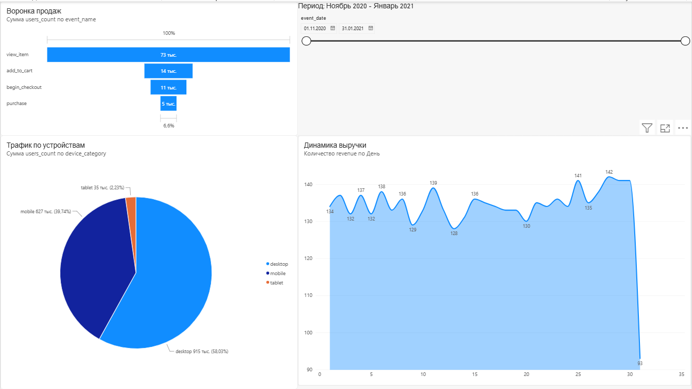

# GA4 E-commerce Product Analytics

Это проект по сквозной продуктовой аналитике на основе публичного датасета **Google Merchandise Store** (GA4, BigQuery). 

**Цель проекта:** Пройти полный цикл работы с данными e-commerce - от валидации сырых событий до построения интерактивных дашбордов, проверки статистических гипотез и сегментации клиентов.

## Стек технологий
*   **База данных:** Google BigQuery (SQL, продвинутый синтаксис для работы с `UNNEST` и вложенными структурами GA4).
*   **Язык анализа:** Python (Pandas, SciPy, Scikit-learn).
*   **BI-инструмент:** Power BI.
*   **Документация:** Markdown.

## Структура проекта
*   `01_docs` — Tracking plan, дизайн A/B-теста и описание выявленных аномалий.
*   `02_sql` — SQL-скрипты: валидация данных, создание витрин, ad-hoc запросы (воронка, RFM).
*   `03_python` — Jupyter-ноутбуки с анализом A/B-теста и RFM-сегментацией.
*   `04_dashboards` — Файл дашборда Power BI и скриншоты.

## Ключевые этапы и инсайты

### 1. Валидация данных
Проведена проверка событий на полноту и логические аномалии. 
*   **Инсайт:** Выявлено, что у **16%** транзакций (906 из 5692) отсутствует параметр `transaction_id`, а также зафиксированы случаи с нулевой суммой заказа. 
*   **Рекомендация:** Проверить интеграцию с платежным шлюзом во избежание искажения выручки в отчетах.

### 2. Анализ воронки продаж
Построена воронка от просмотра товара до покупки на основе созданной витрины `mart_events`.
*   **Ключевой инсайт:** Самое большое падение конверсии происходит на этапе `view_item -> add_to_cart` (около 80% пользователей уходят, не добавив товар в корзину). Второе узкое место — этап оформления заказа (`checkout -> purchase`, теряем 54.5%).
*   **Рекомендация:** Провести качественный UX/UI-анализ карточек товаров и проанализировать причины отказа от оплаты (скрытые комиссии, неудобная форма).

### 3. A/B-тестирование
Смоделирован эксперимент по добавлению блока рекомендаций на карточку товара.
*   **Результат:** Конверсия в Control-группе составила 20.49%, в Test-группе — 20.45%. 
*   **Статистика:** С помощью Z-теста для пропорций (statsmodels) рассчитано `p-value = 0.9074`. Разница статистически **незначима**. 
*   **Вывод:** Фича не дает бизнес-эффекта, внедрение нецелесообразно.

### 4. Машинное обучение RFM-сегментация
С помощью алгоритма K-Means база клиентов разделена на 4 сегмента по давности, частоте и сумме покупок.
*   Выделен сегмент **«VIP»** (высокий чек, высокая частота) - требуют удержания.
*   Выделен сегмент **«В зоне риска»** (высокий чек, но давно не покупали) - рекомендована win-back кампания с промокодами.

## Интерактивный дашборд
На основе агрегированных данных из BigQuery собран дашборд для мониторинга ключевых метрик. Включает в себя фильтрацию по датам, воронку, распределение трафика по устройствам (Mobile опережает Desktop по конверсии на 0.46%) и ежедневную динамику выручки.

